# Spindle: Now Playing for Home Assistant on Stream Deck+

[](https://github.com/VagueDustin/spindle-streamdeck/releases/latest)
[](https://github.com/VagueDustin/spindle-streamdeck/actions/workflows/ci.yml)
[](LICENSE)


<!-- Elgato Marketplace badge: added once the listing is live. -->

Spindle turns a Stream Deck+ dial's touch strip into a live "now playing" display for any Home Assistant `media_player`. It shows the cover art, the title and artist, and the volume. Turn the dial to set the volume, press it to skip tracks, and tap the strip to play or pause. Nothing needs to change on the Home Assistant side.

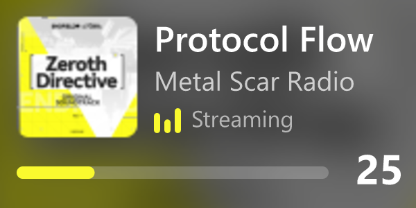

## Gallery

These are real frames captured from the author's Stream Deck+: exactly what the plugin sent to the dial, rendered at 3× the strip's 200×100 pixels through the same pipeline, with the backdrop image under the plugin's SVG overlay.

<table>
  <tr>
    <td>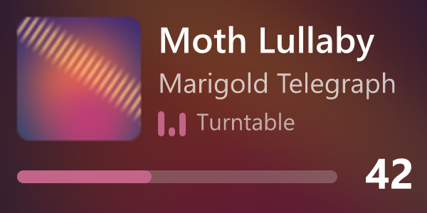<br>Rest view, title scrolling</td>
    <td>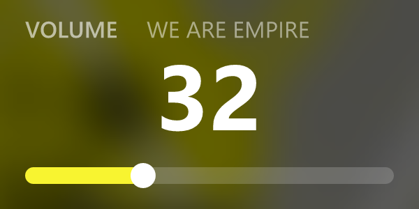<br>Volume takeover</td>
    <td>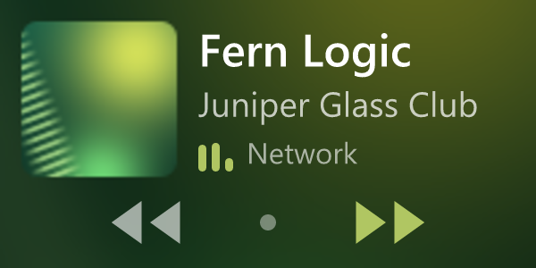<br>Tracks mode, skipping forward</td>
  </tr>
  <tr>
    <td>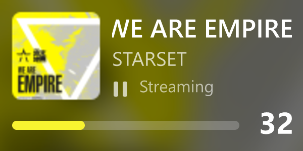<br>Paused</td>
    <td>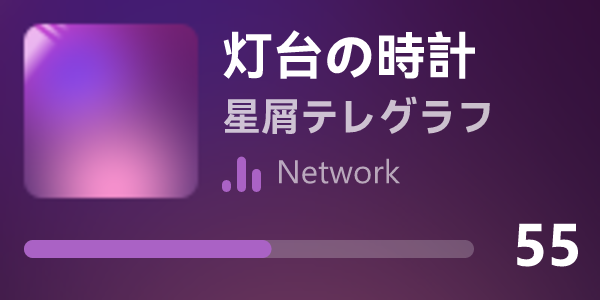<br>CJK title</td>
    <td>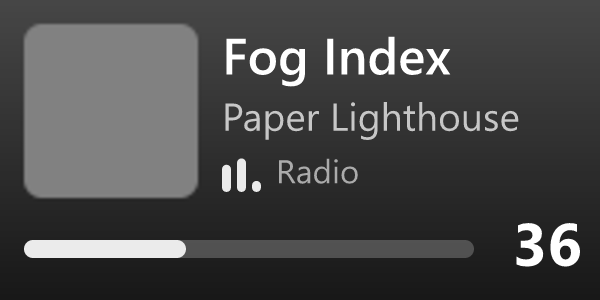<br>No cover art</td>
  </tr>
</table>

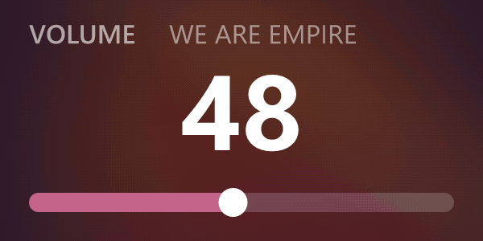

## Features

- Works with **any** Home Assistant `media_player`, using only a URL and a long-lived access token. No scripts, webhooks or add-ons on the Home Assistant side.
- A blurred, saturated copy of the cover fills the strip as a backdrop, with a sharp thumbnail on top.
- An accent colour is picked from each cover and used for the play bars, the volume bar and the tracks-mode flash.
- The title and artist scroll only when they don't fit. Japanese, Chinese and Korean text render with real glyphs.
- Play bars while playing, a pause glyph while paused, and an optional renamed source label beside them.
- Turn the dial and the volume changes on the strip at once, with a full-strip readout. Home Assistant gets one call when you stop turning, not one per click.
- Tracks mode: press the dial, then turn it to skip forward or back.
- Tap the strip to play or pause.
- Several dials can show different players. They share one connection per Home Assistant server.
- Clear messages on the strip when something is wrong, and no endless retries with a rejected token.
- Windows and macOS, in plain JavaScript with no native modules.

## Setup

You need a Stream Deck+ (the model with dials and a touch strip), the Stream Deck app 7.1 or newer, and Home Assistant 2025.10 or newer. Older Home Assistant versions will probably work, but they haven't been tested.

<a id="create-a-token"></a>
### Create a token

1. In Home Assistant, create a token for Spindle.
   1. *(Optional, recommended.)* Create a dedicated user that is **not** an administrator. Go to **Settings → People → Users → Add user** and leave **Administrator** off. (If you don't see the **Users** tab, turn on **Advanced mode** in your profile first.) Spindle needs nothing an administrator has. See [Security and privacy](#security-and-privacy).
   2. Sign in to Home Assistant as that user.
   3. Open your **Profile** (your name at the bottom of the sidebar), then the **Security** tab.
   4. Scroll to **Long-lived access tokens** and select **Create token**. Name it `Spindle`.

      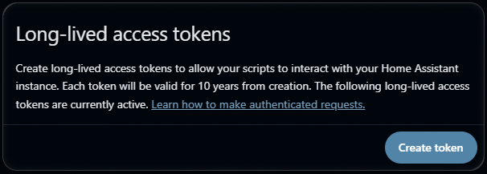

   5. Copy the token now. Home Assistant shows it only once.

      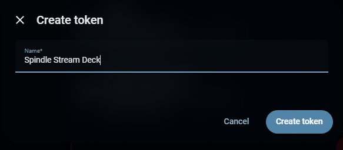

### Install and connect

2. Install Spindle from the Elgato Marketplace, or download `Spindle.streamDeckPlugin` from [Releases](https://github.com/VagueDustin/spindle-streamdeck/releases) and double-click it.
3. In the Stream Deck app, drag **Spindle** onto a dial. It is the **Now Playing** action in the **Spindle** category.

   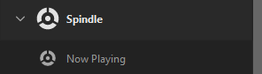

4. In the dial's settings, paste your Home Assistant URL (for example `http://homeassistant.local:8123`) and the token. Wait for the **Status** line to say **Connected**.
5. Pick a media player from the **Media player** list. Its now-playing info appears on the strip.

   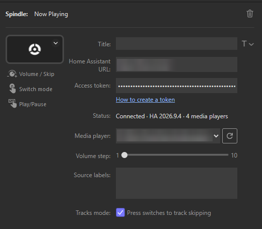

The URL and token are shared by every Spindle dial, so you only enter them once. Each dial picks its own media player, volume step, source labels and tracks mode.

## Controls

| Input | Volume mode (the default) | Tracks mode |
|---|---|---|
| **Turn** | Changes the volume by the volume step (1–10, default 2) per click, with an instant readout. The volume is sent 150 ms after the last click. Turning up while muted unmutes. | Every 4 clicks in one direction skips to the next or previous track, followed by a short pause. |
| **Press** | Switches to tracks mode. | Switches back to volume mode, if the player has volume control. It also switches back by itself after 6 seconds without input. A player with no volume control stays in tracks mode. |
| **Tap the strip** | Play/pause. | Play/pause. |

- **Players that only step the volume** (they support volume up and down but not setting a level): each click sends one step, and the readout shows a bar with no number.
- **Players with no volume control:** turning does nothing in volume mode and the volume row is hidden. The dial starts in tracks mode instead, if tracks mode is available.
- **Tracks mode** is unavailable if you turn it off in the dial's settings, or if the player can't skip tracks. Pressing the dial then does nothing.
- **When the player is off,** turning is ignored, but a tap still sends play/pause. Whether that wakes the player depends on its integration.

## Source labels

The strip shows the player's source (or, failing that, its app name) beside the play bars. To rename sources, put one `Original = Label` per line in the dial's **Source labels** box:

```text
Line In = Turntable
```

Matching ignores upper and lower case. Spindle checks the player's `source` first, then its `app_name`. A source without a label is shown as it is.

## Troubleshooting

### Messages on the strip

| Strip shows | What it means and what to do |
|---|---|
| **Set up Spindle in Stream Deck** | The URL, the token or the media player is missing. Open the dial's settings in the Stream Deck app and fill them in. |
| **Connecting…** | Spindle is connecting to Home Assistant for the first time, or waiting for the player's first state. |
| **Reconnecting…** (badge, strip dimmed) | The connection to Home Assistant dropped. Spindle retries on its own, waiting 1 to 30 seconds between attempts. Input is ignored until it's back. |
| **Check token** | Home Assistant rejected the token, for example because it was revoked or mistyped. Spindle stops connecting until you change the URL or token, apart from one more try each time the plugin or the Stream Deck app restarts. Create a new token (see [Create a token](#create-a-token)) and paste it in. |
| **Player not found** and the entity id | Home Assistant has no entity with that id. It may have been renamed or removed. Pick the player again; the list shows the missing one as `(not found) media_player.…`. |
| **Unavailable** (strip dimmed) | Home Assistant reports the player as `unavailable` or `unknown`, usually because the device is offline. |
| **Off** | The player is off. The strip shows its name over an accent gradient. |
| **Idle** | The player is on, idle or in standby with nothing playing. |
| Play bars at half height | The player is buffering. |
| An alert triangle on the dial | Spindle ignored the input (see the messages above), or Home Assistant returned an error for the command. |

### The Status line in the dial's settings

| Status | What it means and what to do |
|---|---|
| **Enter your Home Assistant URL and token** | One or both are missing or unusable. The URL must start with `http://` or `https://`, or be a bare host such as `homeassistant.local:8123`. |
| **Connecting…** | Spindle is connecting, or waiting for the list of media players. |
| **Connected · HA *version* · *n* media players** | Everything works. *n* is how many media players the token's user can see. |
| **Token rejected** | Home Assistant refused the token. See **Check token** above, and the IP-ban warning below. |
| **Can't reach *host*** | Spindle couldn't open a connection. Check the URL and port, that Home Assistant is running, and that this computer can reach it (try the URL in a browser). |
| **Can't reach *host*: certificate not trusted** | The `https` certificate isn't one this computer trusts. See [HTTPS with a private or self-signed certificate](#https-with-a-private-or-self-signed-certificate). |

### Home Assistant behind a reverse proxy

Spindle talks to Home Assistant over a WebSocket at `/api/websocket`. A reverse proxy (nginx, Caddy, Traefik and similar) must pass WebSocket upgrades through on that path. In nginx, that means `proxy_http_version 1.1;`, `proxy_set_header Upgrade $http_upgrade;` and `proxy_set_header Connection "upgrade";`. If the Home Assistant web UI loads in a browser through the same proxy, the WebSocket is usually fine already, because the UI uses it too.

### `https` and `wss`

Enter the same URL you use in a browser. Spindle works out the WebSocket address from it: `http://` becomes `ws://` and `https://` becomes `wss://`, and the path is always `/api/websocket`. Extra paths such as `/lovelace/0`, trailing slashes and stray spaces are ignored. With `https`, the certificate must be one this computer trusts; see the next section.

### HTTPS with a private or self-signed certificate

Spindle trusts the certificates your operating system trusts: the ones Windows and macOS trust (Edge, Chrome and Safari use the same store). A certificate from a public authority such as Let's Encrypt, or from Home Assistant Cloud (Nabu Casa), just works.

If your Home Assistant uses a certificate from your own or your organisation's certificate authority (CA), add that CA to the operating system's store, then quit and restart the Stream Deck app (Spindle reads the store when it starts):

- **Windows:** import the CA certificate into **Trusted Root Certification Authorities** (double-click the certificate, **Install Certificate…**, and pick that store).
- **macOS:** add the CA certificate to the **System** keychain in Keychain Access, open it, and set **Trust → When using this certificate** to **Always Trust**.

A self-signed certificate (one that is its own CA) that the operating system doesn't trust fails. So does a certificate whose name doesn't match the host in the URL. In both cases the dial's settings show **Can't reach *host*: certificate not trusted**, and the strip shows **Reconnecting…**. Trust the certificate as above, or use the plain `http://` local address instead.

### Cover art doesn't show

- Spindle decodes JPEG and PNG covers only. Some integrations serve WebP or AVIF; for those the strip shows the accent gradient and a placeholder thumbnail instead. Everything else still works.
- Covers larger than 5 MB, or with very large dimensions (above roughly 3,300 pixels on a side for JPEG, or 12 megapixels for PNG, with no side over 16,384 pixels), also fall back to the gradient, which keeps memory use bounded. So do interlaced PNGs and JPEGs with an unusually large number of progressive scans, which would take too long to decode.
- Covers served by Home Assistant are fetched with your token. Covers on other hosts are fetched without it, so a host that needs its own login won't work.
- If a cover fails to load, the strip shows the accent gradient, and Spindle tries again up to 3 times, 5 seconds apart.

### Warning: repeated bad tokens can get this computer banned

If Home Assistant's `http` integration has `ip_ban_enabled: true`, it bans an IP address after `login_attempts_threshold` failed logins, and a rejected token counts as one. Spindle tries a rejected token once and then stops until you change the URL or token. It tries once more each time the plugin or the Stream Deck app restarts, so it won't run into the limit on its own. Pasting a wrong token several times can, though.

If this computer is banned, Home Assistant refuses every connection from it, and the status shows **Can't reach**. To lift the ban, remove the computer's address from `ip_bans.yaml` in Home Assistant's configuration folder, then restart Home Assistant.

## Security and privacy

- **Where the token lives:** Spindle stores the URL and token in the Stream Deck app's global plugin settings on this computer. They are saved in plain text, because Stream Deck has no secret storage for plugins. Global settings aren't included when you export a Stream Deck profile.
- **Use a non-admin user.** Spindle only reads states and controls media players, and a regular user can do both. If the token ever leaks, a non-admin token limits the damage. You can revoke it at any time under **Profile → Security** in Home Assistant.
- **What Spindle calls:** only `media_player` services: `volume_set`, `volume_up`, `volume_down`, `media_play_pause`, `media_next_track` and `media_previous_track`. It reads states with `get_states` and `subscribe_entities`.
- **The token goes only to your Home Assistant.** Cover art on other hosts is fetched without it, and the token is never written to Spindle's logs.
- **Use `https` for a remote Home Assistant.** With an `http://` URL the token crosses the network in clear text, which is only acceptable on a network you trust.
- **No telemetry, no analytics.** Spindle talks only to the Home Assistant URL you enter, plus any external cover-art URLs that Home Assistant points to.

See [PRIVACY.md](PRIVACY.md) for the full privacy policy.

## How it works

Spindle is a Node.js plugin for the Stream Deck SDK. It keeps one WebSocket per Home Assistant server, shared by every dial, and subscribes to each dial's media player. Home Assistant pushes changes as they happen, so Spindle never polls.

Each dial's strip is drawn in two layers:

- **Backdrop:** a 200×100 PNG built once per cover. Spindle decodes the cover in plain JavaScript, blurs and saturates it, darkens it, and draws the rounded thumbnail on top. It is sent only when the cover changes.
- **Foreground:** a small transparent SVG with the text, play bars and volume row, rebuilt for each frame by plain string assembly.

One shared frame loop sends at most 10 strip updates per second across all dials, which is Elgato's limit. A dial that has nothing moving sends nothing at all. A dial with only play bars moving runs at half rate.

**The accent colour.** The first version of this picker reduced each cover to a 12-colour palette and chose the most saturated entry. That fails on dark covers: a near-black colour counts as fully saturated, so a few almost-black specks could win, and lifting them to a readable brightness turned them neon pink. A black-and-red cover came out hot pink. Spindle looks at pixels instead. Every reasonably colourful, reasonably bright pixel votes for its hue in a 36-bin histogram, and each vote is weighted by the square of the pixel's chroma (how far it is from grey). Vivid pixels dominate, and black, white and grey pixels don't count at all. The accent is the weighted average colour around the winning hue, with its lightness and saturation kept in a range that reads well on a dark strip. A cover with almost no colour gets a light grey that keeps the cover's own warm or cool lean. The tests use images generated in code, never real album covers.

**Rendering notes:**

- Stream Deck's SVG renderer ignores `clipPath` and treats the whole `font-family` attribute as a single family name, so a fallback list doesn't work. Spindle clips its scrolling text with masks and names the single family `Segoe UI`. Japanese, Chinese and Korean text still falls back to the system's fonts. On macOS, where Segoe UI isn't installed, the app should fall back to its default font.

## Development

You need Node.js 24 and the Stream Deck app. The Stream Deck CLI (`streamdeck`) comes with the dev dependencies; inside npm scripts it is on the path, and elsewhere use `npx streamdeck` or install it globally with `npm install -g @elgato/cli`.

```sh
npm i
streamdeck link com.vaguedustin.spindle.sdPlugin   # once: install the dev copy into the Stream Deck app
npm run watch                                      # build into com.vaguedustin.spindle.sdPlugin/bin, rebuild on change and restart the plugin
```

Run `streamdeck link` before `npm run watch`: after each rebuild, watch restarts the linked plugin, so there must be a linked copy to restart.

Checks, as CI runs them:

```sh
npm run typecheck
npm run lint
npx vitest run       # unit, integration and golden-render tests
npm run build
npm run scrub        # pre-publish scan for private addresses, tokens and PNG metadata
npm run validate     # streamdeck validate on the plugin folder
```

`npm run screenshots` renders the gallery and the GIF in `docs/images/` with the real renderer, using the fonts installed on your machine. It skips any image listed in `docs/images/captures.json`: `npm run gallery:captures` composes those from frames recorded on a Stream Deck+ by a `SPINDLE_CAPTURE=1` build (the format is described at the top of `scripts/compose-captures.ts`). The golden-render tests use a bundled Noto Sans instead, so they give the same result on every machine.

Never raise the Stream Deck SDK's log level to `trace`. At that level the SDK logs every raw message it exchanges with the Stream Deck app, including the global settings, which hold the Home Assistant token.

## Credits and license

Built on the Elgato [Stream Deck SDK](https://www.npmjs.com/package/@elgato/streamdeck) and [sdpi-components](https://sdpi-components.dev/), with [jpeg-js](https://www.npmjs.com/package/jpeg-js) and [pngjs](https://www.npmjs.com/package/pngjs) for images. Development uses [resvg-js](https://www.npmjs.com/package/@resvg/resvg-js), [gifenc](https://www.npmjs.com/package/gifenc) and [Vitest](https://vitest.dev/). The golden tests bundle [Noto Sans](https://fonts.google.com/noto/specimen/Noto+Sans) under the SIL Open Font License. The design and the accent picker grew out of the author's earlier private plugin.

Spindle is released under the [MIT license](LICENSE).

Home Assistant is a trademark of the Open Home Foundation. Spindle is not affiliated with or endorsed by it or by Elgato.
